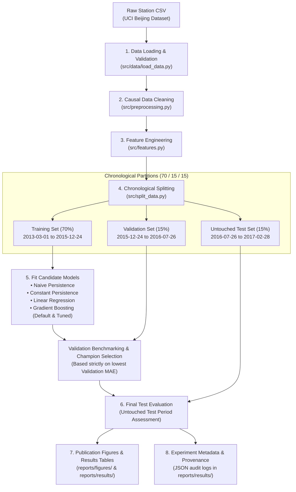

# Reproducibility Protocol & Pipeline Integration Guide

**Role**: Priyanshu — ML Pipeline Integration & Reproducibility Engineer  
**Project**: Air Quality Forecasting via Gradient Boosting and LSTM Models (Phase 1)  
**Branch**: `feature/priyanshu-pipeline-integration`  
**Date**: October 2026  

---

## 1. Executive Summary

This document establishes the end-to-end integration architecture and reproducibility standards for Phase 1 of the Beijing Multi-Site Air Quality Forecasting system. It documents the agreed module interfaces across the five team members, the centralized configuration design, the anti-leakage safeguards enforced across temporal partitions, and the step-by-step verification protocol in clean virtual environments.

---

## 2. Team Interface Integration Checklist

To prevent code duplication, merge regressions, and breaking contract changes, the Phase 1 pipeline integrates directly with each member's specialized modules:

| Team Member | Module Path | Contracted Functions & Classes | Input Schema | Output Schema | Anti-Leakage / Design Invariant |
|:---|:---|:---|:---|:---|:---|
| **Saksham** | `src/data/load_data.py` | `load_station_data(file_path)`<br>`load_all_stations(data_dir)`<br>`validate_data(df)`<br>`build_timestamp(df)` | CSV file path or raw directory containing 18 UCI columns | `pd.DataFrame` with continuous `datetime` (datetime64[ns]), sorted chronologically | Strict monotonic chronological sort; validation checks hourly continuity and duplicate records. |
| **Saksham** | `src/preprocessing.py` | `clean_features(df)`<br>`add_cyclical_wind_features(df)` | DataFrame with missing sensor readings | `Tuple[pd.DataFrame, Dict[str, Any]]` | **Target is never imputed**. Only causal forward-fill (`limit=6h`) and station-level historical medians are used. No future lookahead. |
| **Ajit** | `src/features.py` | `generate_features(df)`<br>`extract_feature_matrix(df, feature_cols)` | Cleaned hourly DataFrame | `Tuple[pd.DataFrame, List[str], Dict]`<br>`Tuple[X, y, metadata]` | Constructs verified target $y_{t+1}$ on continuous hourly grid. All lags ($t-k$) and rolling stats ($t-w:t$) strictly exclude target $t+1$. Pure $(X, y, \text{meta})$ separation. |
| **Ajit** | `src/split_data.py` | `chronological_split(df)`<br>`validate_split_leakage(train, val, test)`<br>`fit_transform_scaler(train_X, val_X, test_X)` | Feature DataFrame; split ratios (0.70 / 0.15 / 0.15) | Train/Val/Test partitions; audit dictionary | Forward-time chronological boundaries ($\max(\text{train}) < \min(\text{val}) < \min(\text{test})$). Zero set overlap. Scalers fit strictly on train partition. |
| **Harsh** | `src/models.py` | `PersistenceBaseline(feature_col)`<br>`LinearRegressionBaseline()`<br>`build_gradient_boosting(**params)`<br>`tune_gradient_boosting(X_tr, y_tr, X_val, y_val)`<br>`get_feature_importance(model, feature_names)` | Feature matrices $X$ and target vectors $y$ | Scikit-learn estimator instances; prediction arrays; feature importance table | Baseline models provide benchmarks (naive $y_t \to y_{t+1}$ and constant mean). Gradient Boosting with tuned tree depth and regularization. |
| **Mihika** | `src/evaluate.py` | `calculate_metrics(y_true, y_pred)`<br>`compare_models(preds_dict, y_true)`<br>`compute_residuals(y_true, y_pred)`<br>`evaluate_by_pollution_tier(y_true, y_pred)`<br>`evaluate_by_temporal_group(y_true, y_pred, ts)`<br>`analyze_prediction_lag(y_true, y_pred)` | Ground-truth $y$ and model predictions | Metric dictionaries, comparison tables, stratified error tables | Single source of truth for MAE, RMSE, $R^2$, MBE. Computes relative improvement over persistence baseline. |
| **Mihika** | `src/visualization.py` | `plot_actual_vs_predicted_timeseries`<br>`plot_actual_vs_predicted_scatter`<br>`plot_residual_distribution`<br>`plot_residuals_over_time`<br>`plot_error_by_hour`<br>`plot_error_by_month`<br>`plot_model_comparison_bars`<br>`plot_feature_importance`<br>`plot_error_by_pollution_tier` | Arrays, Series, DataFrames, destination paths | High-resolution PNG figures (300 DPI, Publication format) | Headless backend (`matplotlib.use("Agg")`) for headless CI/CD and non-interactive servers. |
| **Priyanshu** *(Integration)* | `src/config.py`<br>`src/pipeline.py`<br>`experiments/run_experiments.py`<br>`tests/test_pipeline.py` | `PipelineConfig`<br>`run_pipeline(config, df_input)`<br>`export_dataframe()`<br>`PipelineRunResult` | Typed configurations, CLI arguments, or in-memory DataFrames | End-to-end execution, saved CSV/MD tables, publication figures, JSON metadata | Orchestrates the entire 8-stage pipeline; isolates test period; guarantees full reproducibility across environments. |

---

## 3. End-to-End Pipeline Architecture



---

## 4. Configuration System (`src/config.py`)

All pipeline parameters are managed centrally in typed dataclasses with complete serialization support:

```python
from src.config import PipelineConfig

# 1. Load default configuration
config = PipelineConfig.get_default_config()

# 2. Inspect / modify settings
config.data.station = "Aotizhongxin"
config.split.train_ratio = 0.70
config.split.val_ratio = 0.15
config.split.test_ratio = 0.15
config.model.random_seed = 42

# 3. Export to JSON or load from JSON
config.to_json("experiments/configs/aotizhongxin_run.json")
loaded_config = PipelineConfig.from_json("experiments/configs/aotizhongxin_run.json")
```

### Configuration Hierarchy
- **`DataConfig`**: `data_dir`, `station`, `data_file`, `target_column` ("PM2.5"), `timestamp_column` ("datetime").
- **`CleaningConfig`**: `max_ffill_hours` (6), `encode_wind` (True), `fill_remaining_with_median` (True).
- **`FeatureConfig`**: `horizon` (1h), `new_target_col` ("target_pm25"), `pm25_lags` ([1, 2, 3, 6, 12, 24]), `pollutant_lags` (PM10, NO2, CO), `rolling_windows` ([3, 6, 12, 24]), `include_calendar`, `include_cyclical`, `include_domain_weather`.
- **`SplitConfig`**: `train_ratio` (0.70), `val_ratio` (0.15), `test_ratio` (0.15), `embargo_hours` (0).
- **`ModelConfig`**: `random_seed` (42), `baseline_name` ("Persistence (Naive Lag-1)"), `gb_default_params`, `gb_tuned_params`, `tune_gb_grid`.
- **`OutputConfig`**: `results_dir` ("reports/results"), `figures_dir` ("reports/figures"), `generate_figures` (True).

---

## 5. Leakage Prevention Safeguards

Temporal data leakage is the most critical failure mode in time-series forecasting. The Phase 1 pipeline enforces six mathematical safeguards:

1. **Target Imputation Invariance**:
   Target PM2.5 observations are **never** imputed. Missing target entries remain `NaN` and are tracked in `target_valid`. Missing targets are dropped from supervised optimization matrices so models never train on manufactured labels.

2. **Causal Preprocessing**:
   Missing feature values are filled strictly forward in time (`limit=6h`). Backward interpolation and backward-fill (`bfill`) are explicitly prohibited to prevent future weather or pollutant states from bleeding into the past.

3. **Hourly Continuous Grid Alignment**:
   Lags and targets are computed against a continuous timestamp grid (`freq="1h"`). If a physical hourly observation is absent, the lag correctly resolves to `NaN` rather than erroneously pulling an earlier observation across a temporal discontinuity.

4. **Future Target Exclusion from Features**:
   The prediction target is $y_{t+1}$ (PM2.5 concentration at hour $t+1$). The feature vector $X_t$ is constructed strictly from observations at hour $t$ and historical records ($\le t$). The target column is never included in the candidate feature matrix.

5. **Chronological Splitting & Zero-Overlap**:
   The dataset is partitioned chronologically into forward time blocks:
   $$\max(T_{\text{train}}) < \min(T_{\text{val}}) < \max(T_{\text{val}}) < \min(T_{\text{test}})$$
   Random shuffling is strictly disabled. Set intersection verification confirms $0$ overlapping timestamps across splits.

6. **Untouched Test Period & Learned Parameter Isolation**:
   All candidate transformations (such as feature standardizers) and hyperparameter evaluations are executed strictly on the training and validation sets. The test partition is evaluated exactly once on the selected champion model.

---

## 6. Reproducibility & Metadata Logging

Every pipeline run logs comprehensive provenance metadata to `reports/results/experiment_metadata_{run_id}.json` and `reports/results/experiment_metadata.json`:

- **Run Identification**: Unique UUID, ISO timestamp, experiment name.
- **Environment Provenance**: OS platform, processor architecture, Python version, Git commit hash, Git branch name.
- **Dependency Inventory**: Exact package versions (`pandas`, `numpy`, `scikit-learn`, `matplotlib`, `seaborn`, `pytest`).
- **Data & Partition Boundaries**: Resolved file path, station name, row counts before and after cleaning, timestamp cutoffs, sample counts per partition.
- **Model Parameters**: Hyperparameter dictionary, random seed, training time in seconds.
- **Validation vs. Test Distinction**:
  - Validation table: Used exclusively for hyperparameter tuning and model selection.
  - Final test table: Out-of-sample benchmark evaluating generalization.

---

## 7. Clean-Environment Verification Protocol

Follow these exact terminal instructions to reproduce the complete Phase 1 pipeline in a fresh virtual environment:

### Step 1: Clone Repository & Create Virtual Environment
```bash
git clone https://github.com/CyborgX-hash/Air-Quality-Forecasting.git
cd Air-Quality-Forecasting
git checkout feature/priyanshu-pipeline-integration

python3 -m venv .venv
source .venv/bin/activate
pip install --upgrade pip
pip install -r requirements.txt
```

### Step 2: Download Dataset
Follow instructions in [data/README.md](file:///Users/priyanshuagrahari/Desktop/Air-Quality-Forecasting/data/README.md):
```bash
mkdir -p data/raw
curl -o data/raw/air_quality.zip "https://archive.ics.uci.edu/static/public/501/beijing+multi+site+air+quality+data.zip"
unzip -q data/raw/air_quality.zip -d data/raw_extracted/
mv data/raw_extracted/PRSA_Data_20130301-20170228/*.csv data/raw/
rm -rf data/raw/air_quality.zip data/raw_extracted/
```

### Step 3: Run Complete Test Suite
```bash
pytest -v
```
*Expected result: 60 passing tests (or 62 when raw dataset is present).*

### Step 4: Execute End-to-End Pipeline
```bash
python -m src.pipeline --station Aotizhongxin
```

### Step 5: (Optional) Run Hyperparameter Tuning & Multi-Station Sweep
```bash
# Run with hyperparameter grid search on validation set
python experiments/run_experiments.py --station Aotizhongxin --tune-gb

# Run sweep across all 12 stations
python experiments/run_experiments.py --all-stations
```

---

## 8. Peer Review & Integration Testing Log

### Review of Pull Request #1 (`feature/ajit-time-series-features`)
- **Author**: Ajit Kumar Prasad
- **Modules Inspected**: `src/features.py`, `src/split_data.py`, `tests/test_features.py`, `tests/test_split_data.py`.
- **Interface Verification**: Confirmed that `generate_features` outputs $X_t \to y_{t+1}$ without target contamination. Verified multi-station synchronized chronological splitting and embargo boundary handling.
- **Integration Test**: `tests/test_pipeline.py::test_pipeline_stage_schemas` validated that all 70 features conform to expected mathematical invariants.

### Review of Pull Request #2 (`feature/harsh-model-development`)
- **Author**: Harsh Kumar
- **Modules Inspected**: `src/models.py`.
- **Interface Verification**: Verified `PersistenceBaseline`, `LinearRegressionBaseline`, and `build_gradient_boosting`. Added `experiments/configs/gradient_boosting.json` to satisfy `load_gb_config()`.
- **Integration Test**: Verified that baseline models fit consistently using scikit-learn standard `.fit(X, y)` and `.predict(X)` semantics.

### Review of Pull Request #3 (`feature/mihika-evaluation`)
- **Author**: Mihika Mathur
- **Modules Inspected**: `src/evaluate.py`, `src/visualization.py`, `scripts/run_model_evaluation.py`.
- **Interface Verification**: Confirmed `calculate_metrics`, `compare_models`, and stratified analysis helpers (`evaluate_by_pollution_tier`, `evaluate_by_temporal_group`, `analyze_prediction_lag`).
- **Integration Test**: Verified that `reports/figures/` exports headless plots without GUI display requirements.

---

## 9. Viva Technical Q&A Guide

### Q1: Why is chronological splitting strictly mandatory for air quality time-series?
**Answer**: Air quality and meteorological data exhibit strong autocorrelation (temporal persistence), seasonal cycles, and synoptic weather patterns. Standard random K-fold cross-validation or random train-test shuffling leaks contemporaneous future information into the training set (e.g., training on hour $t+1$ and testing on hour $t$). This artificially inflates performance metrics and results in catastrophic generalization failure when deployed to forecast genuinely unseen future time periods.

### Q2: Why is the PM2.5 target variable never imputed?
**Answer**: Imputing target labels introduces synthetic, model-generated artifacts into the ground truth. In supervised learning, the model must be trained and evaluated strictly against authentic physical sensor measurements. If missing targets were filled (e.g. via interpolation or forward fill), the model would learn to predict the imputation algorithm rather than true atmospheric chemical dynamics.

### Q3: How is data leakage prevented when generating lag and rolling features?
**Answer**: All lag features ($t-1, t-2, \dots$) and rolling window statistics (e.g. 3h, 6h, 12h, 24h moving averages) are constructed strictly using observations up to and including time $t$. The forecast target is defined as $y_{t+1}$. Crucially, rolling computations are partitioned strictly by `station` on an hourly-reindexed datetime grid so that gaps are preserved as `NaN`s rather than erroneously sliding across missing hours.

### Q4: What is the purpose of the validation set versus the test set in Phase 1?
**Answer**: The validation partition (15% of the timeline) serves as the decision gate for hyperparameter tuning and model selection among candidate architectures (Persistence, Linear Regression, Gradient Boosting). Once the champion model is selected on validation MAE, it is evaluated on the final test partition (15% of the timeline) exactly once. The test partition remains untouched throughout development to provide an unbiased estimate of real-world generalization error.
